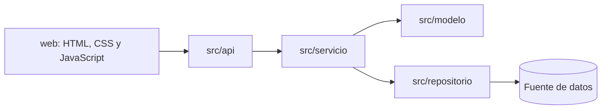

# Arquitectura del proyecto

## Vista de capas

## Responsabilidades

| Capa | Responsabilidad |
| --- | --- |
| `web` | Presentar información y recoger acciones de las personas usuarias. |
| `api` | Recibir solicitudes, validar su formato y devolver respuestas. |
| `servicio` | Implementar los casos de uso del sistema. |
| `modelo` | Representar entidades, sus invariantes y reglas del dominio. |
| `repositorio` | Guardar, consultar y recuperar datos. |
| `tests` | Verificar cada unidad y flujo de trabajo. |

## Convenciones iniciales

- Un caso de uso debe ubicarse en `src/servicio/`.
- Una entidad del dominio debe ubicarse en `src/modelo/`.
- Un adaptador de persistencia debe ubicarse en `src/repositorio/`.
- Una ruta o controlador debe ubicarse en `src/api/`.
- Las pruebas deben reflejar la ubicación del módulo que cubren.
