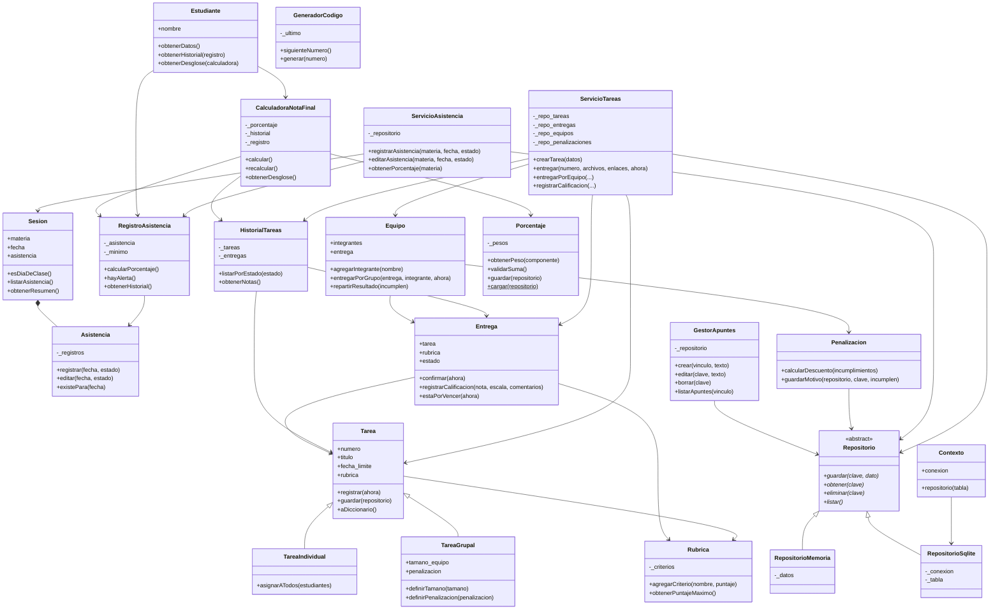

# Diagrama de clases

El siguiente diagrama representa las clases implementadas actualmente y sus dependencias principales. Las rutas HTTP se documentan en los módulos `api_*`; no son clases del dominio.

## Capas y puntos de entrada

- `src/api/app.py` crea la aplicación Flask y carga los módulos `api_asistencia`, `api_tareas` y `api_nota_final`.
- `Contexto` entrega repositorios SQLite a las APIs y servicios.
- `ServicioAsistencia` implementa los casos de uso de HU-01.
- `ServicioTareas` implementa los casos de uso de tareas, entregas, equipos y apuntes.
- `CalculadoraNotaFinal` compone asistencia, tareas y pesos para calcular la nota final.
